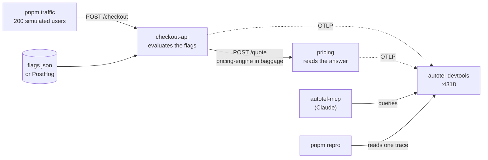
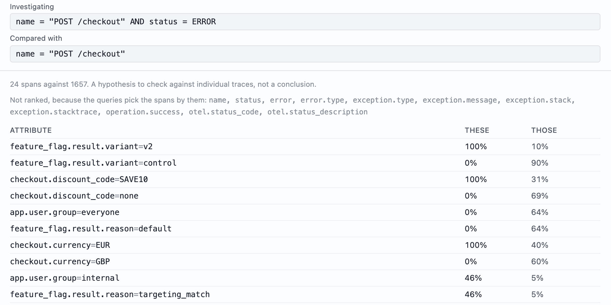
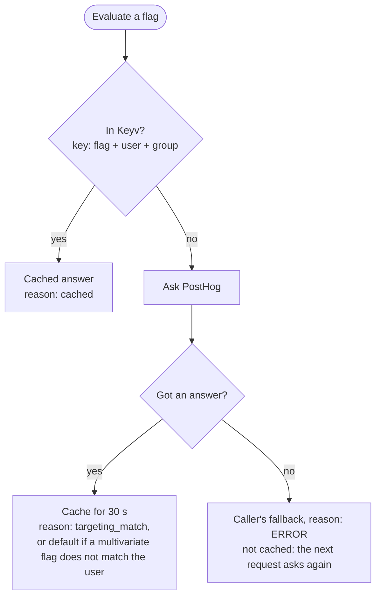

# Feature flags you can reason about

With trunk-based development and continuous delivery, code can reach production
before a feature is released. Feature flags separate the two, and the same commit
then behaves differently per user, per group, and from one minute to the next.
Knowing which commit was deployed is no longer enough: you also need to know
which decisions were made at runtime.

This demo shows what that takes, using [autotel](https://github.com/jagreehal/autotel)
and OpenFeature:

- **Every request records the flags it branched on**, with the variant, the
  reason (`targeting_match`, `split`, `disabled`), who it was evaluated for and
  the flag definition's version, next to the commit that served it.
- **One request gets one answer per flag**, across services, even while someone
  is changing a rollout.
- **A failed pricing request can be reproduced locally** from the recorded inputs
  and flag decisions, not today's flags, and turned into a regression test.
- **A flag change shows up like a deploy**, if the provider reports a flag version:
  when the new version was first seen, and the error rate before and after. `flags.json` does;
  [the PostHog provider here does not](#with-posthog).

No account needed: flags come from `flags.json`. Set `POSTHOG_KEY` and the same
code evaluates them in PostHog instead.

Jump to: [run it](#run-it) · [find a failure](#1-what-do-the-failures-have-in-common) ·
[reproduce it](#2-reproduce-one) · [change a flag](#3-change-a-flag-without-a-deploy) ·
[how it works](#how-one-checkout-works) · [PostHog](#with-posthog) ·
[your own services](#in-your-own-services)

## The app



`pricing-engine` picks between two pricing implementations, both merged to
main. `v2` is on for the `internal` group and 25% of `beta`. It has a bug that
needs three things at once: `v2`, a EUR basket, and a discount code. No single
attribute explains it, which is the point.

Investigating, reproducing and fixing show three different things:

| Tool | What it does | What it shows |
|---|---|---|
| Compare | Ranks what failing requests have in common | Correlation, in production |
| Replay | Changes only the variant, keeps the recorded inputs | Whether the variant decides the outcome for that request |
| Regression test | Asserts the business rule | Whether that case is correct now |

## Run it

```sh
pnpm install
pnpm devtools        # terminal 1, then open http://127.0.0.1:4318
pnpm start           # terminal 2: checkout-api on :4100, pricing on :4101
pnpm traffic         # terminal 3: 10 checkouts a second, 200 simulated users
```

About 8 checkouts a minute fail with `502`: 23 of the 200 users get `v2`, and 12%
of baskets are EUR with a discount code.

## 1. What do the failures have in common?

In devtools, open **Compare**, investigate `name = "POST /checkout" AND status = ERROR`
against `name = "POST /checkout"`, and press Compare:

```
feature_flag.result.variant=v2     100%   vs 12%
checkout.discount_code=SAVE10      100%   vs 31%
checkout.currency=EUR              100%   vs 40%
```

The flag variant, the discount and the currency fall out of the ranking.
Nobody had to guess which attribute to filter on. The ranking says what goes with
the failures, not what causes them: a replay tests that.



Or pick `pricing-engine` in **Experiment or flag** to compare one variant with
another. It reads like an A/B test but is not one: `internal` always
gets `v2`, so the two sides are different users, not a random split.

## 2. Reproduce one

Copy a failing trace id from devtools (or ask Claude, below) and:

```sh
pnpm repro <traceId>
```

```
What was running at 2026-11-21T11:01:55.395Z
  code       3f9c2ab (demo)
  user       user-120 (group beta)
  flag       pricing-engine = v2  (split, flags.json v1)
  flag       express-shipping = off  (split, flags.json v1)
  request    {"currency":"EUR","items":[...],"discountCode":"SAVE10"}

Replaying locally (▶ = what the user got)
  ▶ v2       FAILS   QuoteError: total 4680 != subtotal 7020 - discount 1170
    control  ok      total 5850

Reproduced. Only the v2 branch fails for this request.
```

It replays the variants the trace **recorded**, not what the flags say now: by
the time a bug is reported the rollout has usually moved. It says only what the
results support:

| Verdict | Exit | Meaning |
|---|---|---|
| `variant-specific` | 1 | The recorded error happens again, on the recorded variant only |
| `shared` | 1 | It happens again, but another variant fails too: the flag alone does not explain it |
| `not-reproduced` | 0 | The recorded failure does not occur in this replay. It may be fixed, or its cause may lie outside what is replayed |
| `insufficient-evidence` | 2 | A different error, a checkout that succeeded, a variant this code does not have, or no trace to read |

Add `--json` for CI and agents (`pnpm -s repro <traceId> --json`): the verdict,
every variant's result, the recorded flags and whether the code matches.

### What a replay proves

By default it runs the code you have, which is what you want when checking a
fix, and warns when that is not the commit that served the request. `--strict`
refuses instead: use it to reproduce the original. It cannot tell if the service
was started from a dirty checkout.

It replays the pricing function, which depends only on the request and the
variant. It does not replay the rest of the checkout. Code that also reads a
database, the clock or another service needs those recorded too. And it varies
only the variant: that `v2` fails and `control` does not says nothing on its own
about the currency or the discount.

### Keep it fixed

```sh
pnpm repro <traceId> --generate-test   # writes src/regressions/<traceId>.test.ts
```

The test holds the recorded variant, only the inputs pricing reads, and the rule
that must hold (`total = subtotal - discount`), not the wrong total production
returned. It fails until the bug is fixed. Nothing is written when the failure
does not reproduce, when the request is one pricing should reject, or over a
test that already exists.

Fixing `v2` also fails the test in `src/pricing.test.ts` that documents the planted
bug: delete it.

## 3. Change a flag without a deploy

While traffic runs:

```sh
pnpm rollout pricing-engine 100   # all of beta gets v2
```

The failure rate rises. `service.version` stays the same, `feature_flag.version`
goes from 1 to 2, and every span after the change says so. Ask Claude
"what changed in the last 15 minutes?" and autotel-mcp's `what_changed` reports
it the way it reports a deploy:

```
pricing-engine 1 -> 2 at 11:11:14   error rate 0.8% -> 4.8%
```

That is one observed window, so your rates will differ. The time is the first request
seen under the new version, not when someone saved it: with a cache or little traffic
it can be well after the edit.

Then the kill switch:

```sh
pnpm rollout pricing-engine off   # everyone gets control, reason "disabled"
```

## Ask Claude

`.mcp.json` registers the autotel MCP server against devtools. Start Claude
Code in this folder (with `pnpm devtools` running) and ask:

- "Which checkouts are failing, and what do they have in common?"
- "What changed in the last 15 minutes?"
- "Compare error rate by `feature_flag.result.variant` for POST /checkout."
- "Reproduce the latest failing checkout": it finds a trace id and runs
  `pnpm repro`.

Claude investigates and proposes; the trace and the tests decide.

## How one checkout works


Each choice removes a specific way of getting lost:

| What it does | Without it |
|---|---|
| Evaluate once, at the edge | If a rollout changes between two lookups, one request sees `v2` in one service and `control` in the next |
| Carry the answer pricing needs in baggage | Every service needs the flag provider, and its own chance to disagree |
| Read flags through OpenFeature | Instrumentation at every call site, and a rewrite to change vendor |
| Record the version with the answer | A rollout edit leaves no mark: same commit, different behaviour |
| Record the request and the variants | A replay runs under today's flags, which have usually moved since |
| Put the commit in `service.version` | You know which flags ran, but not which code |

Baggage is a request header, so only read flags from it behind an edge that sets
it. A public service that trusts it lets clients pick their own variants. It can
also propagate to other downstream services, third parties included: strip it at trust
boundaries and keep sensitive values out of it.

Pricing records its answer as `cached` from `baggage`, because that is how it got
it. Why the user got it is the edge's event on the same trace: `split` from
`flags.json`.

**One answer per flag is not one snapshot of all flags.** `checkout-api` evaluates
its two flags one after the other, so a rollout saved in between can give one
from version 1 and one from version 2. Every service that
reads a flag from baggage agrees with the edge about it (one the baggage does not
reach uses its own fallback, recorded with reason `error`). Each event records its
version, so you can see it happened. If your flags must
change together, make them one flag or evaluate them in a batch your provider
answers from one revision.

### How a flag picks a variant

`flags.json` is evaluated in this order, and the reason is recorded with the answer:


The bucket comes from a hash, not a random number, so a user keeps their
variant: raising 25% to 50% adds users without moving anyone already in.

### Where to look

| File | What it shows |
|---|---|
| [`src/telemetry.ts`](src/telemetry.ts) | `init()` with the git sha as `service.version`. autotel finds OpenFeature and registers its hook, so every evaluation is recorded with no code at the call sites |
| [`src/checkout-api.ts`](src/checkout-api.ts) | Evaluates flags once for the user and their group, records the request, carries the one pricing reads with autotel's `featureFlagBaggage()` |
| [`src/pricing-service.ts`](src/pricing-service.ts) | Reads `pricing-engine` through OpenFeature like any service would, from `featureFlagBaggageProvider()` |
| [`src/file-provider.ts`](src/file-provider.ts) | The stand-in for a flag vendor: group rules, sticky percentage rollouts, a kill switch, a version per edit. An invalid edit is refused and the last good flags stay live |
| [`src/posthog-provider.ts`](src/posthog-provider.ts) | The same seam answered by PostHog, cached in Keyv |
| [`src/repro.ts`](src/repro.ts) | Reads a trace back and replays it under its recorded flags |

### What a span carries

autotel records each evaluation with OpenTelemetry's
[feature flag conventions](https://opentelemetry.io/docs/specs/semconv/feature-flags/feature-flags-events/),
so any backend can group by them:

```
feature_flag.key             pricing-engine
feature_flag.result.variant  v2
feature_flag.result.reason   split
feature_flag.provider.name   flags.json
feature_flag.context.id      user-120
feature_flag.set.id          checkout
feature_flag.version         1
service.version              3f9c2ab
```

A span keeps the attributes of the first flag it evaluated. Every evaluation,
the first included, is also a `feature_flag.evaluation` log event on the
trace, which is where `pnpm repro` reads the full set from.

## With PostHog

```sh
cp .env.example .env    # set POSTHOG_KEY
```

Create `pricing-engine` as a multivariate flag (`control`, `v2`) targeting the
person property `group`, and `express-shipping` as a boolean flag. Then:

- spans carry `feature_flag.provider.name = posthog` and PostHog's answers;
- each checkout is captured as `checkout completed` / `checkout failed` with
  `$feature/pricing-engine`, so PostHog insights and experiments break down by
  variant, and `$trace_id`, so a funnel drop-off links to the trace that
  explains it.

### How answers are cached

`flags.json` is already in memory. PostHog can be a network call, so its answers are
cached in [Keyv](https://keyv.org):



- **30 seconds**: the staleness this cache can add. A kill switch takes that long
  plus however long PostHog takes to serve the new answer.
- **Group in the key**: a user who changes group gets a new answer at once.
- **No answer is not cached**: an outage does not pin a flag off.
- **In process**: each instance has its own cache, with no size limit, so instances can
  differ until their entries expire. One request still sees one answer, because the
  edge carries it. A shared Keyv store makes differences rarer but does not guarantee
  that instances agree.

Two things PostHog does not give you here: this provider reports no flag
version, so `what_changed` cannot see a rollout edit, and a cached answer's
reason is `cached`, not why the user originally got it.

For the browser half (session replay on the span, `$trace_id` on browser
events), see
[`autotel-posthog`](https://github.com/jagreehal/autotel/tree/main/packages/autotel-posthog).

## In your own services

1. `init()` from autotel, with `version` set to the commit.
2. Read flags through OpenFeature, with your vendor's provider. That is the
   whole instrumentation.
3. Evaluate once per request at the edge and carry each service the flags it reads.
4. Record the request inputs a replay needs, and nothing personal.
5. Make sure your provider reports a version (`flagMetadata.version`): without
   it a rollout change is invisible.
6. Keep failing traces when you sample, for as long as a bug takes to be
   reported: a trace that was dropped or expired cannot be replayed.
7. Choose the flag cache's TTL as the extra wait you can accept on a kill switch, on
   top of your vendor's own delay.

## License

MIT
