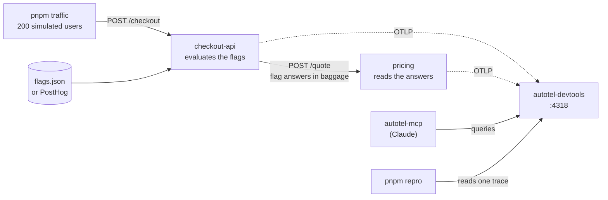
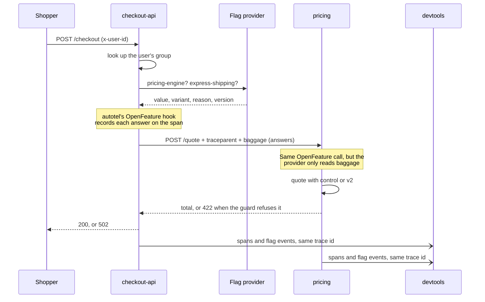
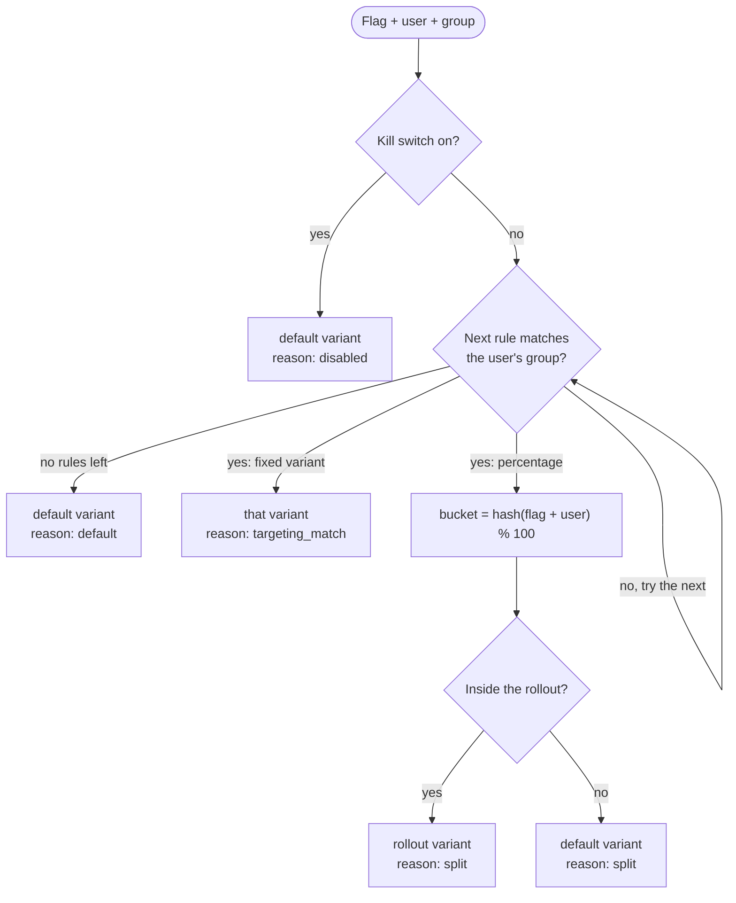
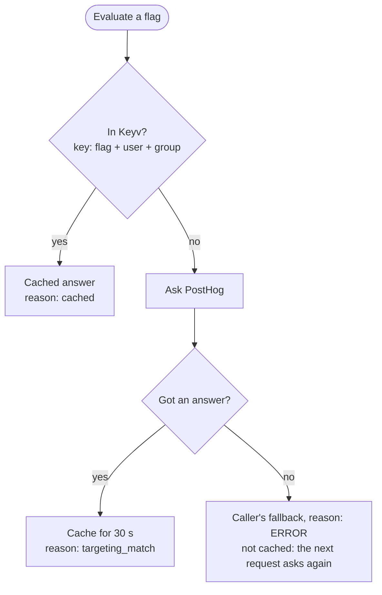

# Feature flags you can reason about

With trunk-based development every change merges to main and ships behind a
flag. That moves the question "what is running?" from the deploy log to the
flag service: the same commit behaves differently per user, per group, and
from one minute to the next.

This demo shows what that takes, using [autotel](https://github.com/jagreehal/autotel)
and OpenFeature:

- **Every request records the flags it branched on**, with the variant, the
  reason (`targeting_match`, `split`, `disabled`), who it was evaluated for and
  the flag definition's version, next to the commit that served it.
- **One request sees one set of flags**, across services, even while someone
  is changing a rollout.
- **Any failed request can be replayed locally** under the exact flags it ran
  with, not today's flags.
- **A flag change shows up like a deploy**: when it happened, and the error
  rate before and after.

> **Pinned versions.** The flag picker in Compare, `flagChanges` in
> `what_changed` and `featureFlagBaggage()` in `autotel/feature-flags` (which
> replaces `src/flag-baggage.ts`) are newer than the versions pinned here. Until
> you upgrade, Compare also ranks `status`/`error` rows (skip them) and
> `what_changed` reports deploys only.

No account needed: flags come from `flags.json`. Set `POSTHOG_KEY` and the same
code evaluates them in PostHog instead.

## The app



`pricing-engine` picks between two pricing implementations, both merged to
main. `v2` is on for the `internal` group and 25% of `beta`. It has a bug that
needs three things at once: `v2`, a EUR basket, and a discount code. No single
attribute explains it, which is the point.

## Run it

```sh
pnpm install
pnpm devtools        # terminal 1, then open http://127.0.0.1:4318
pnpm start           # terminal 2: checkout-api on :4100, pricing on :4101
pnpm traffic         # terminal 3: 10 checkouts a second, 200 simulated users
```

About 8 checkouts a minute fail with `502`: 23 of the 200 users get `v2`, and 12%
of baskets are EUR with a discount code.

## 1. What do the failures have in common?

In devtools, open **Compare**, investigate `name = "POST /checkout" AND status = ERROR`
against `name = "POST /checkout"`, and press Compare:

```
feature_flag.result.variant=v2     100%   vs 12%
checkout.discount_code=SAVE10      100%   vs 31%
checkout.currency=EUR              100%   vs 40%
```

The flag variant, the discount and the currency fall out of the ranking.
Nobody had to guess which attribute to filter on.

Or pick `pricing-engine` in **Experiment or flag** to compare `v2` against
every other variant: the same question as an A/B test, without declaring one.

## 2. Reproduce one

Copy a failing trace id from devtools (or ask Claude, below) and:

```sh
pnpm repro <traceId>
```

```
What was running at 2026-11-21T11:01:55.395Z
  code       3f9c2ab (demo)
  user       user-120 (group beta)
  flag       pricing-engine = v2  (split, flags.json v1)
  flag       express-shipping = off  (split, flags.json v1)
  request    {"currency":"EUR","items":[...],"discountCode":"SAVE10"}

Replaying locally (▶ = what the user got)
  ▶ v2       FAILS   total 4680 != subtotal 7020 - discount 1170
    control  ok      total 5850

Reproduced. Only the v2 branch fails for this request.
```

It replays the variants the trace **recorded**, not what the flags say now: by
the time a bug is reported the rollout has usually moved. If the code has moved
too, it tells you which commit to check out. It exits 1 while the bug
reproduces, so it works as a regression check after the fix.

## 3. Change a flag without a deploy

While traffic runs:

```sh
pnpm rollout pricing-engine 100   # all of beta gets v2
```

The failure rate rises. `service.version` stays the same, `feature_flag.version`
goes from 1 to 2, and every span after the change says so. Ask Claude
"what changed in the last 15 minutes?" and autotel-mcp's `what_changed` reports
it the way it reports a deploy:

```
pricing-engine 1 -> 2 at 11:11:14   error rate 0.8% -> 4.8%
```

Then the kill switch:

```sh
pnpm rollout pricing-engine off   # everyone gets control, reason "disabled"
```

## Ask Claude

`.mcp.json` registers the autotel MCP server against devtools. Start Claude
Code in this folder (with `pnpm devtools` running) and ask:

- "Which checkouts are failing, and what do they have in common?"
- "What changed in the last 15 minutes?"
- "Compare error rate by `feature_flag.result.variant` for POST /checkout."
- "Reproduce the latest failing checkout": it finds a trace id and runs
  `pnpm repro`.

## How one checkout works



Each choice removes a specific way of getting lost:

| What it does | Without it |
|---|---|
| Evaluate once, at the edge | If a rollout changes between two lookups, one request sees `v2` in one service and `control` in the next |
| Carry the answers in baggage | Every service needs the flag provider, and its own chance to disagree |
| Read flags through OpenFeature | Instrumentation at every call site, and a rewrite to change vendor |
| Record the version with the answer | A rollout edit leaves no mark: same commit, different behaviour |
| Record the request and the variants | A replay runs under today's flags, which have usually moved since |
| Put the commit in `service.version` | You know which flags ran, but not which code |

Baggage is a request header, so only read flags from it behind an edge that sets
it. A public service that trusts it lets clients pick their own variants.

### How a flag picks a variant

`flags.json` is evaluated in this order, and the reason is recorded with the answer:



The bucket comes from a hash, not a random number, so a user keeps their
variant: raising 25% to 50% adds users without moving anyone already in.

### Where to look

| File | What it shows |
|---|---|
| [`src/telemetry.ts`](src/telemetry.ts) | `init()` with the git sha as `service.version`. autotel finds OpenFeature and registers its hook, so every evaluation is recorded with no code at the call sites |
| [`src/checkout-api.ts`](src/checkout-api.ts) | Evaluates flags once for the user and their group, records the request, carries the answers to pricing |
| [`src/flag-baggage.ts`](src/flag-baggage.ts) | Baggage out, and a provider that reads baggage on the way in |
| [`src/pricing-service.ts`](src/pricing-service.ts) | Reads `pricing-engine` through OpenFeature like any service would |
| [`src/file-provider.ts`](src/file-provider.ts) | The stand-in for a flag vendor: group rules, sticky percentage rollouts, a kill switch, a version per edit |
| [`src/posthog-provider.ts`](src/posthog-provider.ts) | The same seam answered by PostHog, cached in Keyv |
| [`src/repro.ts`](src/repro.ts) | Reads a trace back and replays it under its recorded flags |

### What a span carries

autotel records each evaluation with OpenTelemetry's
[feature flag conventions](https://opentelemetry.io/docs/specs/semconv/feature-flags/feature-flags-events/),
so any backend can group by them:

```
feature_flag.key             pricing-engine
feature_flag.result.variant  v2
feature_flag.result.reason   split
feature_flag.provider.name   flags.json
feature_flag.context.id      user-120
feature_flag.set.id          checkout
feature_flag.version         1
service.version              3f9c2ab
```

A span keeps the attributes of the first flag it evaluated. Every evaluation,
the first included, is also a `feature_flag.evaluation` log event on the
trace, which is where `pnpm repro` reads the full set from.

## With PostHog

```sh
cp .env.example .env    # set POSTHOG_KEY
```

Create `pricing-engine` as a multivariate flag (`control`, `v2`) targeting the
person property `group`, and `express-shipping` as a boolean flag. Then:

- spans carry `feature_flag.provider.name = posthog` and PostHog's answers;
- each checkout is captured as `checkout completed` / `checkout failed` with
  `$feature/pricing-engine`, so PostHog insights and experiments break down by
  variant, and `$trace_id`, so a funnel drop-off links to the trace that
  explains it.

### How answers are cached

`flags.json` is already in memory. PostHog can be a network call, so its answers are
cached in [Keyv](https://keyv.org):



- **30 seconds**: the longest a kill switch takes to reach a cached user.
- **Group in the key**: a user who changes group gets a new answer at once.
- **No answer is not cached**: an outage does not pin a flag off.
- **In process**: each instance has its own cache, with no size limit, and instances can
  differ for up to 30 seconds. One request still sees one answer, because the
  edge carries it. Give Keyv a shared store if you need instances to agree.

Two things PostHog does not give you here: this provider reports no flag
version, so `what_changed` cannot see a rollout edit, and a cached answer's
reason is `cached`, not why the user originally got it.

For the browser half (session replay on the span, `$trace_id` on browser
events), see
[`autotel-posthog`](https://github.com/jagreehal/autotel/tree/main/packages/autotel-posthog).

## In your own services

1. `init()` from autotel, with `version` set to the commit.
2. Read flags through OpenFeature, with your vendor's provider. That is the
   whole instrumentation.
3. Evaluate once per request at the edge and carry the answers downstream.
4. Record the request inputs a replay needs, and nothing personal.
5. Make sure your provider reports a version (`flagMetadata.version`): without
   it a rollout change is invisible.

## License

MIT
